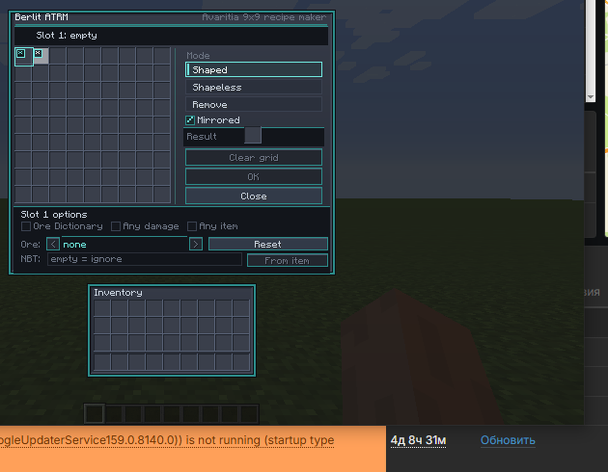

# Berlit_ATRM

Визуальный редактор 9×9-рецептов Avaritia для Minecraft **1.7.10** — аналог MTRM
(MineTweakerRecipeMaker), но для стола Extreme Crafting. Интерфейс сделан в стиле мода **Berlit**
(тёмная панель, бирюзовая рамка, 9-slice кит).



## Что умеет

- Открывается командой **`/atrm`** (нужен уровень оператора 2; в одиночной игре — читы).
- Сетка **9×9** с «призрачными» предметами: предмет не расходуется, клик по клетке с предметом
  на курсоре копирует его, клик с пустым курсором — очищает клетку, другой предмет — заменяет.
- У каждой клетки есть маленькая кнопка **`*`** — она появляется при наведении на левый верхний
  угол клетки (и остаётся видимой у выбранной клетки), чтобы не засорять сетку.
- Над сеткой — строка выбранной клетки: иконка, название, damage и включённые флаги.
- Меню рецепта: **Shaped / Shapeless / Remove**, зеркальность, ячейка результата, OK, Close,
  очистка сетки.
- Настройки клетки: **Ore Dictionary** (циклический выбор записи), **Any damage**,
  **Any item** (`<*>`), **NBT-фильтр** (SNBT, например `{display:{Name:"Test"}}`) и кнопка
  «Из предмета».
- **Удаление рецепта**: положите предмет в ячейку результата, переключите режим на **Remove** и
  нажмите **OK** — удаляются все рецепты Avaritia с таким результатом (с учётом damage/NBT,
  если они заданы).
- Рецепты применяются сразу, без перезапуска и без `/mt reload`, и сохраняются между запусками.
- Экспорт в читаемый MineTweaker-скрипт: `config/berlimatrm/BerlitATRM.zs` (файл не
  подхватывается автоматически — его можно скопировать в `scripts/`).
- API для MineTweaker/CraftTweaker: `mods.berlimatrm.Avaritia`.

## Зависимости

| Мод | Версия | Обязательность |
|---|---|---|
| Minecraft Forge | 1.7.10-10.13.4.1614 | обязательно |
| **Avaritia** | 1.13 (1.7.10) | обязательно |
| **MineTweaker 3** (в GTNH-сборках — CraftTweaker 1.7.10) | 3.0.x | обязательно |

`@Mod(dependencies = "required-after:MineTweaker3;required-after:Avaritia")` — без них мод не
загрузится. На сервере и клиенте нужны одинаковые моды.

Отображаемое имя и артефакт — **Berlit_ATRM**; технический `modid` — `berlimatrm`
(используется в путях `config/berlimatrm` и `mods.berlimatrm.Avaritia`).

## Установка

1. Соберите jar (см. ниже) или возьмите `build/libs/Berlit_ATRM-*.jar`.
2. Положите его в `mods/` клиента и сервера вместе с Avaritia и MineTweaker/CraftTweaker.

## Сборка

Нужен JDK 25 для Gradle и JDK 8 для целевого тулчейна (RFG скачивает/использует их сам).

```powershell
.\tools\dev-env.ps1 build        # -> build/libs/Berlit_ATRM-<версия>.jar
.\tools\dev-env.ps1 runClient    # dev-клиент с Avaritia и MineTweaker
.\tools\dev-env.ps1 runServer    # dev-сервер
```

Если PowerShell блокирует выполнение скриптов (`ExecutionPolicy Restricted`):

```powershell
powershell -NoProfile -ExecutionPolicy Bypass -File .\tools\dev-env.ps1 build
```

`tools\dev-env.ps1` ищет JDK в `.tools` этого репозитория, а если его нет — в соседнем
`..\BerlitMod\.tools`; путь можно задать через `ATRM_TOOLS`. Gradle-кэш и локальное
Maven-зеркало настраиваются автоматически (`.gradle-home`).

Перед коммитом: `.\tools\dev-env.ps1 spotlessApply`.

## Как пользоваться

1. `/atrm` — открыть редактор.
2. Возьмите предмет из инвентаря (внизу экрана) или из NEI и кликните в нужную клетку сетки.
   Призрак появится в клетке, предмет останется на курсоре.
3. Наведите курсор на левый верхний угол клетки и нажмите `*`, чтобы выбрать её, затем настройте
   ингредиент:
   - **Ore Dictionary** — ингредиент принимает любую запись ore dictionary (стрелки `<` `>`
     переключают запись);
   - **Any damage** — игнорировать damage;
   - **Any item** — подходит любой непустой предмет;
   - **NBT** — фильтр по тегу (SNBT). Пустое поле = NBT не проверяется; сравнение идёт по
     принципу «все указанные ключи должны присутствовать»;
   - **Из предмета** — подставить текущий тег предмета в поле NBT.
4. Положите предмет-результат в ячейку **Result** (правый верх меню). Размер стака = количество
   в результате рецепта.
5. **OK** — рецепт добавлен. Для бесформенного рецепта переключите режим на **Shapeless**.
6. **Remove** + предмет в Result + **OK** — удалить рецепты с таким результатом.
7. **Clear grid** — очистить сетку. **Close** — закрыть.

Правый клик по клетке тоже очищает её. Shift-клик по призрачной клетке ничего не делает
(чтобы случайно не перетащить предмет).

## Сохранение и экспорт

| Файл | Назначение |
|---|---|
| `config/berlimatrm/recipes.dat` | основной файл (NBT), загружается при старте сервера |
| `config/berlimatrm/BerlitATRM.zs` | человекочитаемый экспорт для MineTweaker (не автозагружается) |
| `config/berlimatrm.cfg` | `requireOp`, `maxRecipes`, `exportScript` |

Рецепты добавляются прямо в `ExtremeCraftingManager`, поэтому работают в столе Extreme Crafting
и видны в NEI (штатный NEI-хендлер Avaritia). Удаления built-in рецептов тоже сохраняются: при
следующем запуске они применяются заново после инициализации Avaritia.

`/atrm export` — перезаписать `.zs`; `/atrm reload` — перечитать `recipes.dat`.

## MineTweaker API

```zenscript
import mods.berlimatrm.Avaritia;

// 9 строк по 9 ингредиентов; null — пустая клетка.
Avaritia.addShaped(<minecraft:diamond>, [
    [<minecraft:iron_block>, null, null, null, null, null, null, null, null],
    [null, null, null, null, null, null, null, null, null],
    [null, null, null, null, null, null, null, null, null],
    [null, null, null, null, null, null, null, null, null],
    [null, null, null, null, null, null, null, null, null],
    [null, null, null, null, null, null, null, null, null],
    [null, null, null, null, null, null, null, null, null],
    [null, null, null, null, null, null, null, null, null],
    [null, null, null, null, null, null, null, null, null]
], true);

Avaritia.addShapeless(<minecraft:diamond>, [<ore:ingotIron>, <minecraft:coal>]);
Avaritia.remove(<minecraft:diamond>);

// NBT-фильтр и любой damage:
Avaritia.addShaped(<minecraft:diamond>, [[<minecraft:iron_sword>.withTag({display:{Name:"X"}}).anyDamage()]], false);
```

`addShaped(..., mirrored)` — третий аргумент необязателен (по умолчанию `false`).
Скриптовые рецепты живут только в скрипте (в `recipes.dat` не попадают) и корректно
откатываются при `/mt reload`.

## Автотест

```powershell
$env:BERLIT_ATRM_SELFTEST = '1'
.\tools\dev-env.ps1 runServer
```

В логе появятся строки `BERLIT_ATRM_SELFTEST shaped/nbt/ore/shapeless/removal/nbt_text/persist_save/persist_reload/export/persist_remove: ok` и
`BERLIT_ATRM_SELFTEST summary: passed=10 failed=0`. Тест добавляет рецепты через `addRuntime`
(без записи в конфиг), проверяет shaped/NBT/oreDict/shapeless-мэтчинг, удаление, сохранение и
перезагрузку `recipes.dat`, экспорт `.zs`, после чего восстанавливает исходные файлы конфига.

## Ограничения

- Редактор предназначен только для 9×9-рецептов Avaritia; обычные 3×3-рецепты продолжайте
  делать в MineTweaker (`recipes.addShaped`).
- NEI показывает только «родные» рецепты Avaritia: созданные в GUI рецепты — собственные
  `IRecipe`, и штатный NEI-хендлер Avaritia их пропускает. Крафт в столе Extreme Crafting при
  этом работает; при необходимости можно добавить свой NEI-хендлер.
- Удаление по результату удаляет **все** 9×9-рецепты с этим предметом (это поведение MTRM).
- NBT в экспорте `.zs` поддерживается не для всех типов (массивы байт/интов и не-идентификаторы
  в ключах пропускаются) — такие рецепты всё равно сохраняются в `recipes.dat`.
- В мультиплеере нужен OP (уровень 2), если `requireOp=true`.
- Если окно игры маленькое для экрана 340×382 (например, 854×480 при GUI Scale 2), мод сам
  временно уменьшает масштаб интерфейса до подходящего и возвращает настройку после закрытия —
  экран не обрезается.

## Структура

```
src/main/java/ru/beggar/berlimatrm/
  BerlitAtRm.java        — @Mod, обязательные зависимости
  CommonProxy/ClientProxy
  Config.java
  command/CommandAtRm    — /atrm, /atrm export, /atrm reload
  gui/                   — ContainerAtRm, GuiAtRm, AtRmLayout, виджеты, кит
  recipe/                — модель ингредиентов/рецептов, IRecipe, хранилище, экспорт
  network/               — пакеты GUI, очередь серверных задач
  compat/AvaritiaTweaker — ZenScript API
  selftest/              — headless-проверка
tools/preview_gui.py     — макет интерфейса (Pillow)
```

## Лицензия

MIT (см. `LICENSE`).
